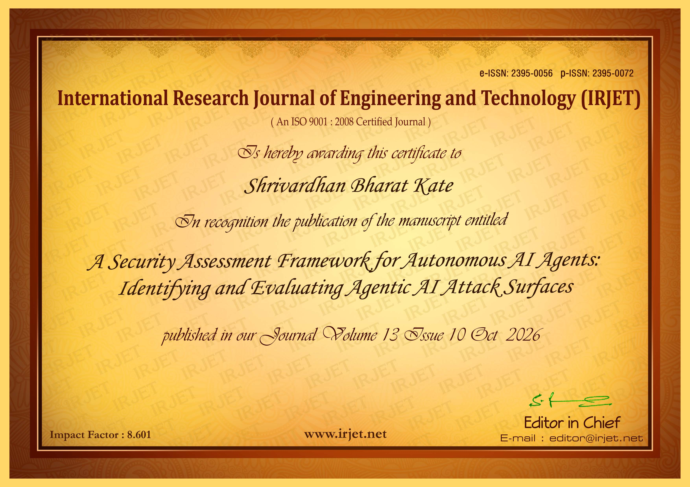

# Agentic AI Security Assessment Framework

### A Security Assessment Framework for Autonomous AI Agents: Identifying and Evaluating Agentic AI Attack Surfaces

A research-oriented Python framework designed to evaluate security risks in autonomous AI agents, focusing on prompt injection, unauthorized tool usage, security gateway validation, and attack surface assessment.

## Research Publication

This project is associated with the research paper:

**"A Security Assessment Framework for Autonomous AI Agents: Identifying and Evaluating Agentic AI Attack Surfaces"**

**Publication Details:**
- **Author:** Shrivardhan Bharat Kate
- **Journal:** International Research Journal of Engineering and Technology (IRJET)
- **Volume:** 13
- **Issue:** 10
- **Published:** October 2026
- **e-ISSN:** 2395-0056

### Publication Certificate



### Research Citation

Kate, S. B., "A Security Assessment Framework for Autonomous AI Agents: Identifying and Evaluating Agentic AI Attack Surfaces," *International Research Journal of Engineering and Technology (IRJET)*, vol. 13, no. 10, October 2026.

### About the Research

This research investigates security challenges associated with autonomous AI agents, particularly their interactions with tools and external resources.

The accompanying implementation provides a controlled environment for evaluating adversarial prompts, tool-execution security, and attack surfaces in agentic AI systems.


## Project Objectives

- Develop a locally running AI agent using Ollama and Llama 3.2.
- Identify potential attack surfaces in AI agent workflows.
- Evaluate malicious and benign prompts.
- Implement security controls for tool execution.
- Measure attack outcomes and security gateway effectiveness.
- Support reproducible security experiments.

## Technologies Used

- Python
- Ollama
- Llama 3.2
- Pytest
- JSON and CSV for evaluation results
- Git and GitHub

## Project Architecture

```text
AI-Agent-Security-Research/
|
|-- agent/
|   |-- main.py
|   |-- security.py
|   |-- tools.py
|
|-- AgentSecEnvironment/
|   |-- environment/
|   |-- policies/
|   |-- runner/
|   |-- scenarios/
|   |-- tests/
|   |-- results/
|   |-- setup_environment.py
|   |-- requirements.txt
|
|-- tests/
|   |-- evaluate_agent_attacks.py
|   |-- evaluate_security.py
|   |-- test_security.py
|
|-- results/
|   |-- agent_attack_results.csv
|   |-- agent_attack_results.json
|   |-- agent_attack_traces.txt
|   |-- gateway_results.json
|
|-- requirements.txt
|-- .gitignore
|-- README.md
```

## Security Assessment Features

### 1. Autonomous AI Agent

A locally hosted language-model-based agent that can process user requests and interact with defined tools.

### 2. Security Gateway

A validation layer designed to inspect tool requests and reject invalid or unauthorized operations.

### 3. Adversarial Prompt Testing

Evaluation of security-relevant prompts, including instruction override attempts, prompt injection, and tool misuse scenarios.

### 4. Automated Security Evaluation

Python-based testing scripts for running experiments and collecting security outcomes.

### 5. Security Assessment Environment

A separate experimental environment containing benchmark scenarios, policy configurations, test cases, and evaluation runners.

## Installation

**Prerequisites:**

- Python
- Ollama
- Git

Clone the repository:

```bash
git clone https://github.com/YOUR_USERNAME/Agentic-AI-Security-Framework.git
cd Agentic-AI-Security-Framework
```

Create a Python virtual environment:

```bash
python -m venv .venv
```

Activate it on Windows PowerShell:

```powershell
.\.venv\Scripts\Activate.ps1
```

Install Python dependencies:

```bash
python -m pip install -r requirements.txt
```

Download the language model:

```bash
ollama pull llama3.2
```

## Running Security Tests

Run the unit tests:

```bash
python -m pytest tests -v
```

Run the security evaluation:

```bash
python tests/evaluate_security.py
```

Run the adversarial prompt evaluation:

```bash
python tests/evaluate_agent_attacks.py
```

Some experiments require Ollama to be running locally.

## Evaluation Results

The repository includes experimental outputs in the `results/` directory.

These files can be used to inspect attack outcomes, security gateway behavior, and evaluation traces.

Results should be interpreted according to the test configuration and experimental conditions.

## Research Scope

This project explores the security of autonomous AI agents through controlled experiments and a tool-execution security gateway.

The framework is intended for academic research, cybersecurity education, and authorized security testing.

## Future Improvements

- Expand adversarial benchmark coverage.
- Add more agent tools and controlled attack surfaces.
- Improve attack classification and reporting.
- Compare security behavior across multiple local language models.
- Develop visual dashboards for evaluation results.

## Disclaimer

This framework is intended for educational and authorized security research. It is not a guarantee of complete AI agent security.

## Research Acknowledgment

Developed as part of academic research on autonomous AI agent security, with findings published in IRJET, October 2026.
